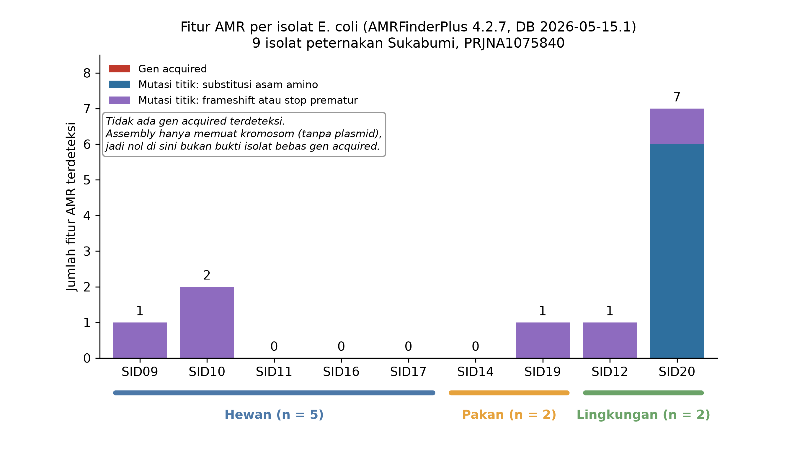
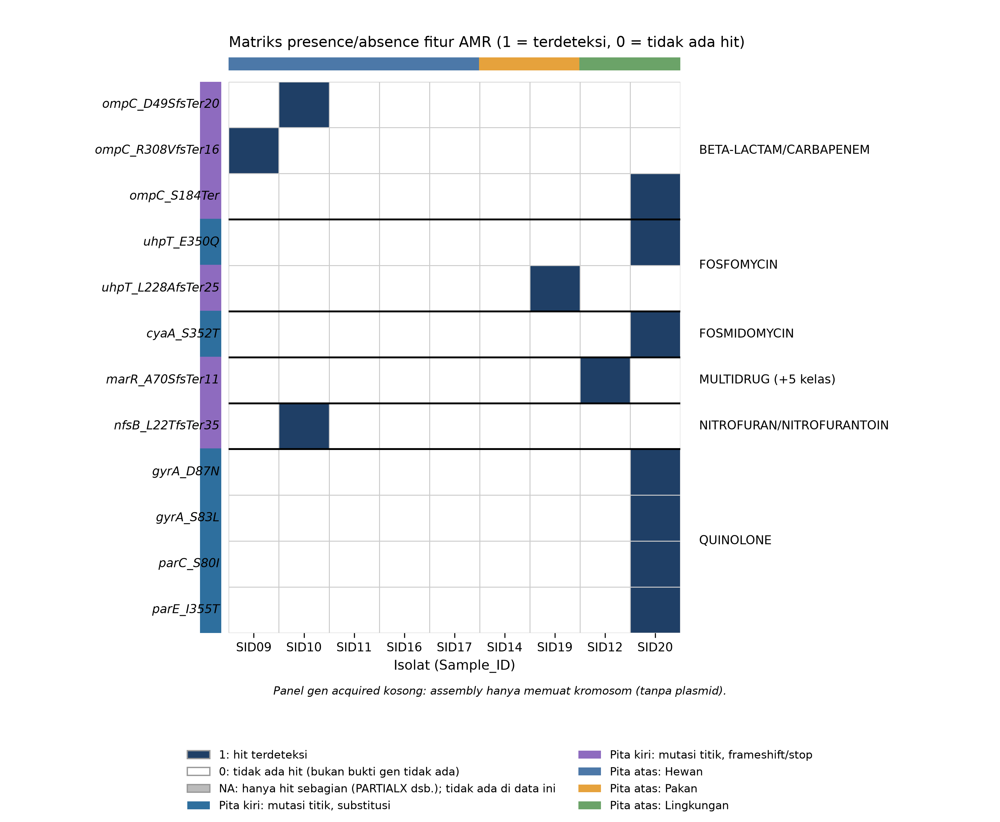

# Antimicrobial Resistance Genes in *Escherichia coli* from a Livestock Farm in Sukabumi, Indonesia

> **Status:** draft report in `report/report.md`. All numbers below come from my own analysis of public assemblies, and every claim is limited to in-silico detection.

## Summary
I screened nine public *E. coli* genome assemblies from one livestock farm in Sukabumi, Indonesia (BioProject PRJNA1075840) for known antimicrobial-resistance (AMR) determinants. Assembly quality was checked with QUAST 5.3.0 and AMR features were detected with AMRFinderPlus 4.2.7 (database V4.2-2026-05-15.1) on usegalaxy.eu. All nine assemblies passed the pre-defined quality limits. AMRFinderPlus reported 12 AMR-associated features in five of the nine isolates, all of them chromosomal point mutations, and no acquired resistance gene. One environmental isolate (SID20) carried seven of the 12 features, including `gyrA_S83L`, `gyrA_D87N` and `parC_S80I`. The assemblies contain no plasmid sequence, so the absence of acquired genes is not informative.

## Research question
Which known antimicrobial-resistance-associated genes are detected in a selected set of *E. coli* genome assemblies from poultry/livestock sources in Indonesia or Southeast Asia, and how do the detected gene profiles differ between isolates?

## Objectives
- Select 8–10 *E. coli* assemblies from a single public BioProject using pre-defined criteria.
- Record accessions and metadata so the dataset can be reproduced.
- Assess assembly statistics with QUAST.
- Screen assemblies with one primary AMR tool (AMRFinderPlus).
- Build a gene-by-isolate presence/absence matrix and at least two figures.
- Interpret results against published literature, stating limitations.

## Data
- **BioProject:** [PRJNA1075840](https://www.ncbi.nlm.nih.gov/bioproject/PRJNA1075840) (described by the submitter only as "Whole genome sequence of 12 Samples"; I used the nine isolates collected at a farm in Sukabumi city and excluded four isolates with a different location, year and assembly level).
- **Source study:** not published. The BioProject links to no paper and no raw reads are in the SRA. According to the NCBI assembly report, the submitter is Genomik Solidaritas Indonesia, sequencing used an Oxford Nanopore GridION (22–58× coverage), and the assembly method is listed only as medaka v1.11.1, a polishing tool.
- **Isolates:** five animal (duck ×2, swan, goat, cattle), two feed (duck feed, laying-hen feed) and two environmental, collected 21 August to 14 September 2023.
- **Selection criteria:** see `workflow/analysis_notes.md` (written on 18 November 2026, before any data were downloaded).
- **Download date:** 25 November 2026.
- **Accessions:** see `metadata/genome_metadata.csv`. Short IDs (`SID09` to `SID20`) are used in all tables, Galaxy dataset names and figures.

Raw genome files are not stored in this repository. Retrieve them from NCBI using the listed accessions.

## Software and databases
| Step | Tool | Version | Database release | Platform / settings |
|---|---|---|---|---|
| Assembly QC | QUAST | 5.3.0+galaxy3 | – | usegalaxy.eu; no reference, co-assembly mode, scaffolds split at N gaps, `--min-contig 500` |
| AMR screening | AMRFinderPlus | 4.2.7+galaxy0 | V4.2-2026-05-15.1 | usegalaxy.eu; nucleotide input, `--organism Escherichia`, `--ident_min -1`, `--coverage_min 0.5`, `--translation_table 11`, no `--plus` |
| Tables and figures | Python 3.11, pandas 3.0.1, seaborn 0.13.2, matplotlib 3.11.2 | – | – | local, see `requirements.txt` |

The Galaxy history is public: https://usegalaxy.eu/u/ollyblu/h/ecoli-sukabumi-amr

## Workflow
1. Select the nine assemblies by the pre-defined criteria and record metadata in `metadata/genome_metadata.csv`.
2. Download the assemblies from NCBI with the NCBI Datasets command-line tool (`datasets download genome accession ... --include genome`) and upload them to a Galaxy history, one dataset per isolate named by `Sample_ID`.
3. Run QUAST on usegalaxy.eu and copy the summary into `results/assembly_quality.csv`. Apply the exclusion limits from QC.watch (total length 4.10–6.30 Mb, GC 50.09–51.13%); none of the nine isolates was excluded.
4. Run AMRFinderPlus on usegalaxy.eu, one job per isolate, and save each raw table as `results/raw_tool_outputs/SIDxx_amrfinder.tsv`.
5. Curate hits with the pre-defined rules (`EXACTX`, `ALLELEX`, `BLASTX` and `POINTX` count as present; partial or unknown categories are kept as notes), then build the matrix and figures.

### Re-running the local part
The Galaxy steps (3 and 4) are documented above and in `workflow/analysis_notes.md`; their raw outputs are already in `results/`. To regenerate the tables and figures from those outputs:

```bash
pip install -r requirements.txt
python run_all.py   # curate_hits.py -> build_matrix.py -> plot_figures.py
```

`run_all.py` runs, in order, `scripts/curate_hits.py` (raw tables to `results/amr_hits_curated.csv`), `scripts/build_matrix.py` (to `results/amr_presence_absence.csv`) and `scripts/plot_figures.py` (to `figures/`).

I ran the three scripts in an empty copy of the project (only the raw tool outputs, QC table, metadata and scripts) and the two CSV files and both PNG files were byte-identical to the committed ones.

## Results
- Assembly quality: `results/assembly_quality.csv`
- Curated AMR hits: `results/amr_hits_curated.csv`
- Presence/absence matrix: `results/amr_presence_absence.csv`
- Figures: `figures/`
- Report: `report/report.md`





## Main findings
- All nine assemblies passed the quality limits. Total length without N ranged from 4.276 to 4.392 Mb, GC from 50.70 to 50.95%, and each assembly is one chromosomal scaffold with 36–51 N gaps (about 5% of the sequence).
- AMRFinderPlus reported 12 AMR features, all with method `POINTX`: six amino-acid substitutions and six frameshift or premature-stop variants. No acquired gene was detected.
- Five isolates had at least one feature: SID20 (7), SID10 (2), SID09, SID12 and SID19 (1 each). SID11, SID14, SID16 and SID17 had none.
- SID20, an environmental isolate, carried `gyrA_S83L`, `gyrA_D87N`, `parC_S80I` and `parE_I355T` (quinolone-associated), plus variants in `ompC`, `uhpT` and `cyaA`.
- With two to five isolates per source group, no comparison between animal, feed and environmental isolates is supported.

## Limitations
- This is an in-silico database screen of public assemblies. It does not demonstrate phenotypic resistance or clinical susceptibility.
- "Not detected" means not detected under the chosen tool, database version and thresholds.
- Assembly fragmentation, database coverage and detection thresholds can affect calls.
- A small selected dataset does not represent all *E. coli* populations.
- The assemblies contain no plasmid sequence, so plasmid-borne genes would be missed. The number of acquired genes found (zero) is a lower bound, and it cannot be told from public data whether plasmids were not assembled or not submitted.
- About 5% of each assembly is N, and a gene inside a gap cannot be detected.
- Half of the calls are frameshift or premature-stop variants in long-read (Nanopore) assemblies, which could partly reflect residual indel errors. The reads are not public, so I could not check this.
- The sample is nine isolates from one farm over about four weeks, with five animal, two feed and two environmental isolates. They are not independent and were not typed.
- The BioSample location field reads "Sekolah Vokasi IPB", while the isolation source and coordinates point to a farm in Sukabumi. I used the isolation source.
- The QC.watch reference page for *E. coli* carries a *warn* quality flag, so the quality ranges are a guide, not a guarantee.

## References
The full list is in `report/report.md` and `report/references.md`. Main sources:
- Feldgarden M, et al. (2021). AMRFinderPlus and the Reference Gene Catalog facilitate examination of the genomic links among antimicrobial resistance, stress response, and virulence. *Scientific Reports*. https://doi.org/10.1038/s41598-021-91456-0
- Gurevich A, et al. (2013). QUAST: quality assessment tool for genome assemblies. *Bioinformatics*. https://doi.org/10.1093/bioinformatics/btt086
- Hardiati A, et al. (2021). Isolation and detection of antibiotics resistance genes of *Escherichia coli* from broiler farms in Sukabumi, Indonesia. *Journal of Advanced Veterinary and Animal Research* 8(1):84–90. https://doi.org/10.5455/javar.2021.h489
- QC.watch, species-specific quality control ranges for *E. coli*: https://www.qc.watch/Escherichia/Escherichia_coli/ (accessed 25 November 2026)
- AMRFinderPlus wiki, *Interpreting results*: https://github.com/ncbi/amr/wiki/Interpreting-results (accessed 25 November 2026)
