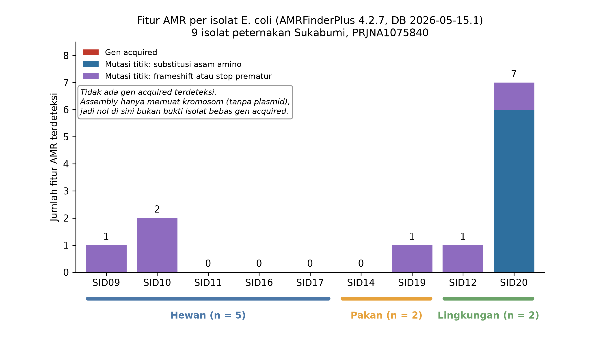
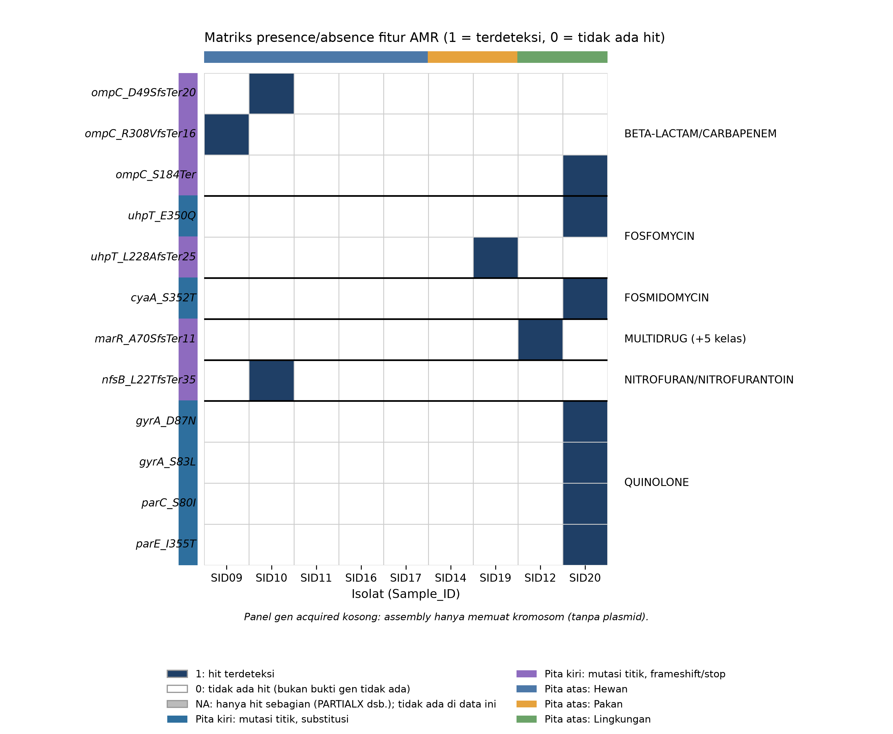

# In-silico screening for antimicrobial resistance determinants in nine *Escherichia coli* genome assemblies from a livestock farm in Sukabumi, Indonesia

*Draft 2, 26 November 2026. Every number in the Results section can be traced to a file in `results/`. Items marked `[TODO]` need a source or a decision before publication.*

## Abstract

Antimicrobial resistance (AMR) in livestock-associated *Escherichia coli* is a One Health concern, and public genome assemblies allow a quick, reproducible first look at the resistance determinants they carry. I screened nine *E. coli* assemblies from one BioProject (PRJNA1075840; isolates from animals, animal feed and the environment of a farm in Sukabumi) with QUAST 5.3.0 and AMRFinderPlus 4.2.7 (database V4.2-2026-05-15.1, `--organism Escherichia`, without `--plus`) on usegalaxy.eu. All nine assemblies passed the pre-defined quality limits. AMRFinderPlus reported 12 AMR-associated features in five of the nine isolates. All were chromosomal point mutations (six amino-acid substitutions and six frameshift or premature-stop variants), and no acquired resistance gene was detected. One environmental isolate (SID20) carried seven of the 12 features, including `gyrA_S83L`, `gyrA_D87N`, `parC_S80I` and `parE_I355T`; four isolates had no hit. Each assembly is a single chromosomal scaffold without plasmid sequence, so the absence of acquired genes says little about the isolates. The results describe database matches only. They do not show phenotypic resistance, and n = 9 is too small to compare sources.

## Introduction

*E. coli* is a gut commensal of humans and animals and a common sentinel organism for AMR surveillance. Antibiotics are used in livestock for treatment, prevention and growth promotion, and resistant bacteria and their genes can move between animals, feed, the environment and people (Hardiati et al., 2021). A 2019 survey of broilers in Sukabumi found phenotypic resistance to several antibiotic classes in most cloacal *E. coli* isolates, using disk diffusion and PCR for five genes (Hardiati et al., 2021).

Public assemblies can be screened for known resistance determinants without laboratory work. AMRFinderPlus compares assemblies with a curated reference gene catalogue (Feldgarden et al., 2021), and its developers have evaluated genotype calls against measured phenotypes (Feldgarden et al., 2019). A genotype table is still not a susceptibility test. This project asks which known AMR-associated genes and mutations are detected, under fixed rules, in a small set of assemblies from one Indonesian farm, and how the profiles differ between isolates.

## Methods

### Dataset and inclusion criteria

I wrote the inclusion criteria on 18 November 2026, before downloading any data (`workflow/analysis_notes.md`). An assembly was included if NCBI recorded the organism as *Escherichia coli*, it belonged to BioProject PRJNA1075840, the BioSample isolation source was a livestock farm in Sukabumi, and the assembly level was *Chromosome*. This selected all nine isolates of the Sukabumi group. Four isolates in the same BioProject were excluded because their location, collection year and assembly level differed. I used GenBank (GCA) accessions and did not count RefSeq (GCF) copies again.

The isolates were collected between 21 August and 14 September 2023 (Table 1): five from animals (domestic duck, two; swan; goat; cattle), two from feed (duck feed, laying-hen feed) and two from the environment. The animal, feed and environment grouping is my own mapping of the BioSample host field, not an NCBI category. I downloaded the assemblies on 25 November 2026 with the NCBI Datasets command-line tool; accessions and metadata are in `metadata/genome_metadata.csv`. The BioProject links to no publication and has no raw reads in the SRA, so the assemblies could not be regenerated. The NCBI assembly report lists Oxford Nanopore GridION sequencing at 22 to 58× coverage and medaka v1.11.1, a polishing tool, as the only assembly method; the assembler is not documented. Each isolate has a short `Sample_ID` (SID09 to SID20) used in all tables, Galaxy dataset names and figures.

### Assembly quality control

I ran QUAST 5.3.0+galaxy3 (Gurevich et al., 2013) on usegalaxy.eu without a reference genome, in co-assembly mode, with scaffolds split at runs of N (`--split-scaffolds`) and a minimum contig length of 500 bp. Each assembly is one chromosomal scaffold with N gaps, so contig counts and total length come from the split version. Total length excludes N; the length including N is kept in `results/assembly_quality.csv`.

I fixed the exclusion limits on 25 November 2026, before running QUAST, from the species-specific QC.watch ranges for *E. coli* (scheme `qualibact-v1.0`; https://www.qc.watch/Escherichia/Escherichia_coli/, accessed 25 November 2026; Alikhan, *Species specific quality control of bacterial de novo genome assemblies using QC.watch*, https://gitlab.com/cgps/tools/qualibact). An assembly would be excluded if total length was below 4.10 Mb or above 6.30 Mb, or GC content below 50.09% or above 51.13%. Values inside these limits but near the edges (length 4.1 to 4.4 Mb or 5.7 to 6.3 Mb; GC 50.09 to 50.25% or 50.88 to 51.13%) were flagged WARN and still analysed. An earlier, unsourced range (4.5 to 5.9 Mb; GC 49.5 to 51.5%) was replaced before QUAST was run. Contig count and N50 were reported only.

### AMR detection

I ran AMRFinderPlus 4.2.7+galaxy0 (Feldgarden et al., 2021) on usegalaxy.eu with database release V4.2-2026-05-15.1 (read from the job log): nucleotide input, `--organism Escherichia` (which enables point-mutation detection), `--translation_table 11`, minimum identity at the curated thresholds (`--ident_min -1`), minimum coverage 0.5, no `--plus`, one job per isolate. Only rows with element type AMR were analysed; virulence and stress-response genes are outside this study.

Detection rules were also fixed in advance (`workflow/analysis_notes.md`; method definitions from https://github.com/ncbi/amr/wiki/Interpreting-results, accessed 25 November 2026). A hit with method `EXACTX`, `ALLELEX`, `BLASTX` or `POINTX` counts as present (1). Hits with `PARTIALX`, `PARTIAL_CONTIG_ENDX`, `INTERNAL_STOPX`, `HMM` or any other method are recorded as notes and entered as NA, not 0 or 1. Acquired genes and chromosomal point mutations are shown separately, and point mutations are split into amino-acid substitutions (subtype `POINT`) and frameshift or premature-stop variants (subtype `POINT_DISRUPT`).

### Data processing and figures

Three Python 3.11 scripts in `scripts/` (pandas 3.0.1, seaborn 0.13.2, matplotlib 3.11.2) process the raw AMRFinderPlus tables in `results/raw_tool_outputs/`: `curate_hits.py` builds the curated hit table and warns on unknown method categories, `build_matrix.py` builds the presence/absence matrix and cross-checks per-isolate counts against the curated table, and `plot_figures.py` draws Figures 1 and 2. I checked the curated table by hand for one isolate (SID20), and the counts matched the script output. I ran no statistical tests, because with nine isolates and two to five per source group they would not be informative. The scripts are in the public repository (https://github.com/ollyblu/ecoli-amr-sukabumi) at commit `[COMMIT_HASH]`; running them on an empty copy of the project gave byte-identical CSV and PNG files.

## Results

### Dataset and assembly quality

All nine assemblies passed the exclusion limits, so none was removed (Table 1). Total length without N ranged from 4.276 to 4.392 Mb (4.497 to 4.611 Mb with N) and GC content from 50.70 to 50.95%. Contig counts ranged from 37 to 52 and N50 from 245,980 to 355,971 bp. All nine isolates fell in the WARN band for length, and five (SID09, SID10, SID11, SID12, SID17) also for GC.

**Table 1.** Isolates and assembly statistics (`metadata/genome_metadata.csv`, `results/assembly_quality.csv`).

| Sample_ID | Accession | Host or source | Group | Length (bp, no N) | Contigs | N50 (bp) | GC (%) |
|---|---|---|---|---|---|---|---|
| SID09 | GCA_037201835.1 | Duck (*Anas platyrhynchos javanica*) | Animal | 4,306,831 | 41 | 354,726 | 50.89 |
| SID10 | GCA_037201905.1 | Swan (*Cygnus cygnus*) | Animal | 4,299,802 | 42 | 355,408 | 50.89 |
| SID11 | GCA_037201895.1 | Duck (*A. p. javanica*) | Animal | 4,276,201 | 43 | 354,777 | 50.91 |
| SID16 | GCA_037201825.1 | Goat (*Capra aegagrus hircus*) | Animal | 4,392,356 | 37 | 318,717 | 50.80 |
| SID17 | GCA_037201885.1 | Cattle (*Bos taurus*) | Animal | 4,372,159 | 42 | 245,980 | 50.95 |
| SID14 | GCA_037201855.1 | Laying-hen feed | Feed | 4,318,881 | 44 | 355,221 | 50.76 |
| SID19 | GCA_037201845.1 | Duck feed | Feed | 4,302,117 | 41 | 355,971 | 50.87 |
| SID12 | GCA_037201875.1 | Environment | Environment | 4,301,763 | 45 | 355,885 | 50.89 |
| SID20 | GCA_037201865.1 | Environment | Environment | 4,279,473 | 52 | 259,199 | 50.70 |

Each assembly is one chromosomal scaffold (one FASTA record per file) with 36 to 51 N gaps, which make up roughly 209 to 274 kb (about 5%) of each file. No plasmid sequence is present.

### AMR determinants detected

AMRFinderPlus reported 12 AMR-type rows across the nine assemblies, and all 12 passed the counting rules (`results/amr_hits_curated.csv`). All had method `POINTX`, so no row was assigned `PARTIALX`, `PARTIAL_CONTIG_ENDX`, `INTERNAL_STOPX` or `HMM`, and the matrix has no NA cells. No acquired resistance gene was detected. The 12 hits were 12 different features, six of subtype `POINT` and six of subtype `POINT_DISRUPT` (`results/amr_presence_absence.csv`).

**Table 2.** Features detected per isolate (`results/amr_hits_curated.csv`). Class is the AMRFinderPlus class and subclass annotation.

| Isolate | Feature | Subtype | Class / subclass | Identity (%) | Coverage (%) |
|---|---|---|---|---|---|
| SID09 | *ompC*_R308VfsTer16 | frameshift/stop | Beta-lactam / carbapenem | 91.67 | 100.00 |
| SID10 | *nfsB*_L22TfsTer35 | frameshift/stop | Nitrofuran / nitrofurantoin | 98.62 | 100.00 |
| SID10 | *ompC*_D49SfsTer20 | frameshift/stop | Beta-lactam / carbapenem | 90.96 | 100.00 |
| SID12 | *marR*_A70SfsTer11 | frameshift/stop | Multidrug (listed: ampicillin, chloramphenicol, quinolone, rifampin, tetracycline) | 98.61 | 100.00 |
| SID19 | *uhpT*_L228AfsTer25 | frameshift/stop | Fosfomycin | 100.00 | 100.00 |
| SID20 | *cyaA*_S352T | substitution | Fosmidomycin | 99.29 | 100.00 |
| SID20 | *gyrA*_D87N | substitution | Quinolone | 98.97 | 99.66 |
| SID20 | *gyrA*_S83L | substitution | Quinolone | 98.97 | 99.66 |
| SID20 | *ompC*_S184Ter | frameshift/stop | Beta-lactam / carbapenem | 90.19 | 100.00 |
| SID20 | *parC*_S80I | substitution | Quinolone | 99.73 | 100.00 |
| SID20 | *parE*_I355T | substitution | Quinolone | 97.23 | 63.02 |
| SID20 | *uhpT*_E350Q | substitution | Fosfomycin | 99.78 | 100.00 |

Five of the nine isolates had at least one feature: SID20 (7), SID10 (2), and SID09, SID12 and SID19 (1 each). SID11, SID14, SID16 and SID17 had none (Figure 1). By class, the 12 features were quinolone (4, all in SID20), beta-lactam/carbapenem (3, *ompC*, in SID09, SID10 and SID20), fosfomycin (2), multidrug (1), nitrofuran (1) and fosmidomycin (1). By source group, the five animal isolates had three features in total (SID09 and SID10 only), the two feed isolates had one (SID19), and the two environmental isolates had eight (SID12 one, SID20 seven) (Figure 2).

*gyrA*_D87N and *gyrA*_S83L in SID20 were reported at identical coordinates and are listed as two rows. *parE*_I355T has a coverage of 63.02%, below the 90% usually expected of a complete match, but it is a `POINTX` call and was counted under the pre-defined rule.

**Figure 1.** Number of AMR features detected per isolate, split into acquired genes, amino-acid substitutions and frameshift or premature-stop variants. The acquired-gene panel is empty because the assemblies contain no plasmid sequence, which does not show that the isolates lack acquired genes.

**Figure 2.** Presence/absence matrix of the 12 features in the nine isolates, grouped by drug class, with isolate source above the columns. A filled cell means AMRFinderPlus detected the feature under the stated thresholds.

## Discussion

### What the data show

AMRFinderPlus detected only chromosomal point mutations in these nine assemblies, and most of the signal comes from one isolate. SID20, from the environment, carries substitutions at *gyrA* codons 83 and 87, *parC* codon 80 and *parE* codon 355, along with *ompC*, *uhpT* and *cyaA* variants. Substitutions at *gyrA* S83 and D87 and *parC* S80 are among the best-known changes in the quinolone resistance-determining region of *E. coli* `[TODO: cite a primary source or review, e.g. search "quinolone resistance-determining region gyrA S83L D87N parC S80I Escherichia coli"]`. The combination in SID20 is a candidate for reduced quinolone susceptibility, but only a susceptibility test can show it. No other isolate had a quinolone-associated hit.

Six of the 12 features are frameshift or premature-stop variants in *ompC*, *uhpT*, *nfsB* and *marR*. AMRFinderPlus links these to reduced susceptibility to beta-lactams/carbapenems (*ompC*), fosfomycin (*uhpT*), nitrofurans (*nfsB*) and several drug classes (*marR*). I have not checked the individual catalogue entries or the primary literature behind them `[TODO: read the AMRFinderPlus catalogue entry for each of these genes]`, and the effect of any single loss of function depends on the genetic background. The three *ompC* calls at 90.2 to 91.7% identity to the reference may reflect a divergent *ompC* allele or sequence differences beyond the flagged variant; I did not examine this.

I make no comparison between sources. The environmental group has the highest count (8 features), but SID20 alone accounts for seven of them, while the other environmental isolate (SID12) has one. The animal group has three features in five isolates and the feed group one in two. With two to five isolates per group, a single outlier decides every group summary.

### Comparison with published data from the area

The closest local study surveyed broiler cloacal *E. coli* in Sukabumi in 2019 (Hardiati et al., 2021). It found high phenotypic resistance (ampicillin in 25/25 isolates, tetracycline in 22/25, nalidixic acid and ciprofloxacin in most) and detected *tet*(A) and *bla*TEM by PCR. The two studies differ in host, year, isolates and method, so their numbers are not comparable: my dataset has no broilers and no phenotype, and uses assemblies instead of PCR for five genes. Two points can still be made. The absence of *tet*(A) and *bla*TEM in my results is uninformative, because both are often carried on mobile elements and the assemblies contain no plasmid sequence. And the earlier study detected *gyrA* by PCR (a 626 bp amplicon) in all isolates, which says nothing about mutations, because every *E. coli* carries the gene. Its authors attribute the quinolone resistance to probable *gyrA* mutations without sequencing them; sequence-level evidence of such mutations is what genome data can add, as in SID20.

Whole-genome studies of livestock-associated *E. coli* in Southeast Asia, such as Trongjit et al. (2021) on pigs in Thailand and Iryawati et al. (2026) in Indonesia, report AMR genes with their genomic location, including genes on plasmid contigs `[TODO: read the Methods and Discussion of both papers before citing them for a specific claim]`. My assemblies lack that information.

### Limitations

1. **Genotype is not phenotype.** No susceptibility data exist for these isolates. A hit is a database match, and the absence of a hit does not mean susceptibility. Fluoroquinolone resistance has been described in an *E. coli* isolate without changes in the resistance-determining region (Sato et al., 2013) `[TODO: read the paper; this claim rests on its title]`.
2. **No plasmid sequence.** Each assembly is of level *Chromosome*, a single scaffold with N gaps. Plasmid-borne genes would be missed if the plasmids were not assembled or not submitted. The assembly method is undocumented and the reads are not public, so I cannot tell which applies. Total length without N (4.28 to 4.39 Mb) is below the QC.watch median for *E. coli* (5.11 Mb), which fits missing sequence but does not prove it, since genome sizes vary widely. The zero acquired genes is a lower bound.
3. **Gaps and assembly errors.** About 5% of each assembly is N, and a gene inside a gap cannot be detected. Half of my calls are frameshifts, which can also arise from residual indel errors in polished Nanopore assemblies. I could not check this without the reads, so the six frameshift/stop calls are less certain than the six substitutions.
4. **Small, unbalanced sample.** n = 9 (five animal, two feed, two environmental) from one farm over about four weeks. The isolates were chosen by availability under one BioProject, are not independent, and were not typed, so clonal relationships are unknown.
5. **One tool, one database version.** AMRFinderPlus 4.2.7 with database V4.2-2026-05-15.1 reports only point mutations that are already curated. Other databases (CARD, or ResFinder with PointFinder) may give different results.
6. **Quality-control limits.** Every isolate is in the WARN band for length, and the QC.watch page for *E. coli* itself carries a *warn* quality flag, so the ranges are a guide.
7. **Metadata inconsistency.** The BioSample location field reads "Sekolah Vokasi IPB", while the isolation source and coordinates point to a farm in Sukabumi. I used the isolation source and coordinates.
8. **Excluded group.** The four isolates of the second group in the same BioProject were not analysed.

### Next steps

With laboratory access, I would first test SID20 for ciprofloxacin and nalidixic acid susceptibility by broth microdilution or disk diffusion, plus fosfomycin and nitrofurantoin on the isolates with *uhpT* and *nfsB* variants, to see whether the genotype predicts the phenotype. Re-sequencing SID20 with long and short reads would show whether the frameshift calls are real and whether plasmids exist. Quinolone-associated mutations appeared only in an environmental isolate, but with n = 2 for that group this may be chance and does not show a transmission route. A second AMR tool and MLST typing would be useful extensions.

## Data and code availability

Assembly accessions are in `metadata/genome_metadata.csv`. Raw AMRFinderPlus and QUAST outputs, curated tables, the matrix, figures and scripts are in the project repository (https://github.com/ollyblu/ecoli-amr-sukabumi). The Galaxy history is at https://usegalaxy.eu/u/ollyblu/h/ecoli-sukabumi-amr.

## References

Reference metadata were retrieved from Crossref and each DOI was checked by hand on 25 November 2026. Entries marked † have been read only as far as the abstract or title.

- Feldgarden M, et al. (2019). Validating the AMRFinder tool and resistance gene database by using antimicrobial resistance genotype-phenotype correlations in a collection of isolates. *Antimicrobial Agents and Chemotherapy*. https://doi.org/10.1128/aac.00483-19
- Feldgarden M, et al. (2021). AMRFinderPlus and the Reference Gene Catalog facilitate examination of the genomic links among antimicrobial resistance, stress response, and virulence. *Scientific Reports*. https://doi.org/10.1038/s41598-021-91456-0
- Gurevich A, et al. (2013). QUAST: quality assessment tool for genome assemblies. *Bioinformatics*. https://doi.org/10.1093/bioinformatics/btt086
- Hardiati A, et al. (2021). Isolation and detection of antibiotics resistance genes of *Escherichia coli* from broiler farms in Sukabumi, Indonesia. *Journal of Advanced Veterinary and Animal Research* 8(1):84–90. https://doi.org/10.5455/javar.2021.h489
- Iryawati, et al. (2026). † Whole-genome sequencing reveals antimicrobial resistance genes in commensal *Escherichia coli* from healthy pregnant women living near pig slaughterhouses in Indonesia. *International Journal of One Health*. https://doi.org/10.14202/ijoh.2026.192-204
- Sato T, et al. (2013). † Fluoroquinolone resistance mechanisms in an *Escherichia coli* isolate, HUE1, without quinolone resistance-determining region mutations. *Frontiers in Microbiology*. https://doi.org/10.3389/fmicb.2013.00125
- Trongjit S, et al. (2021). † Whole genome sequencing and characteristics of *Escherichia coli* with co-existence of ESBL and *mcr* genes from pigs. *PLOS ONE*. https://doi.org/10.1371/journal.pone.0260011
- Alikhan N-F. *Species specific quality control of bacterial de novo genome assemblies using QC.watch*. https://gitlab.com/cgps/tools/qualibact (accessed 25 November 2026).
- NCBI. AMRFinderPlus wiki, *Interpreting results*. https://github.com/ncbi/amr/wiki/Interpreting-results (accessed 25 November 2026).
